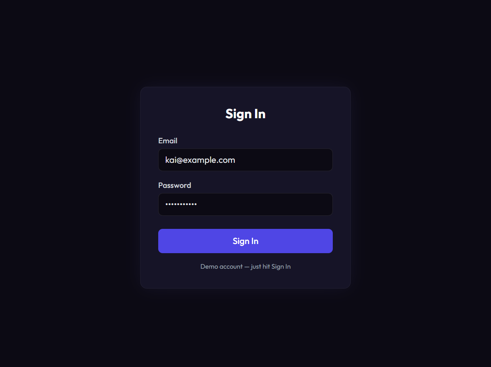
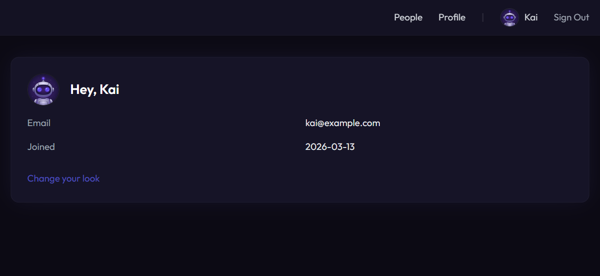
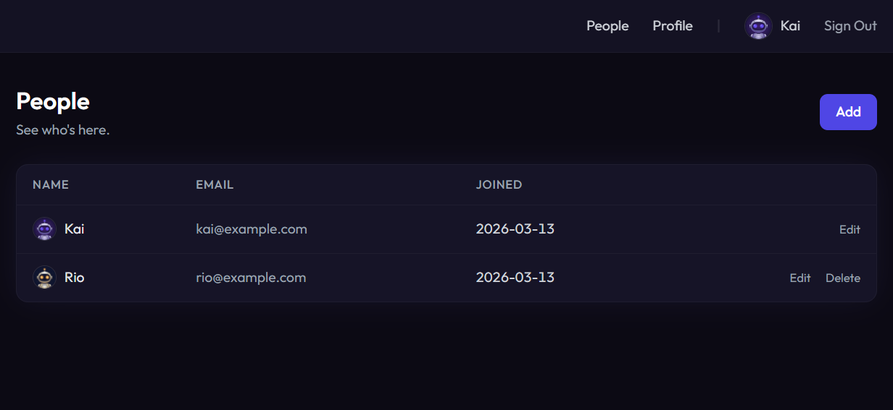
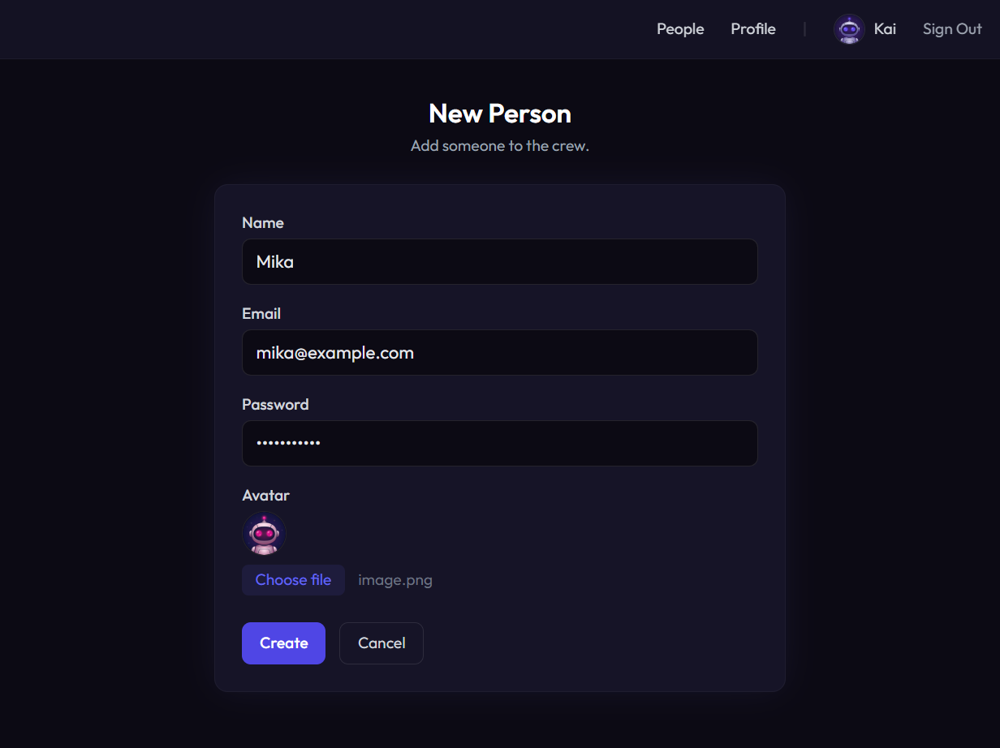
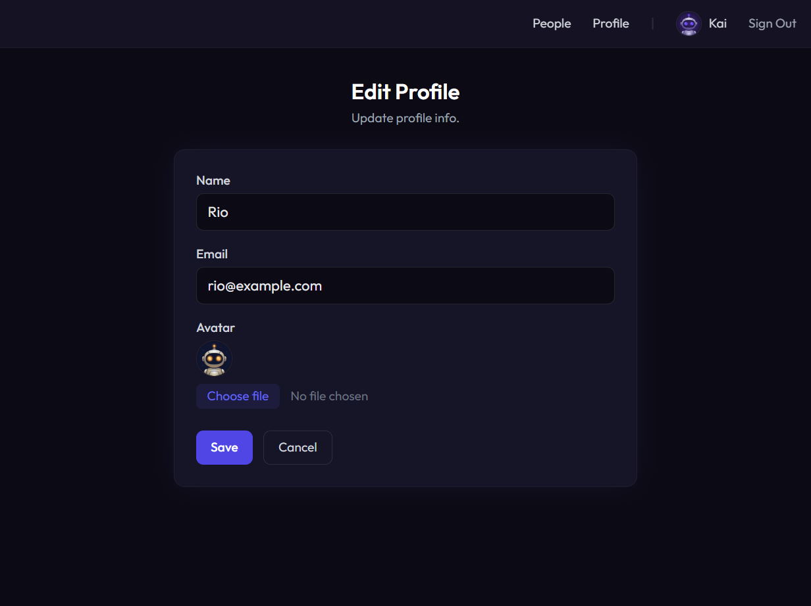
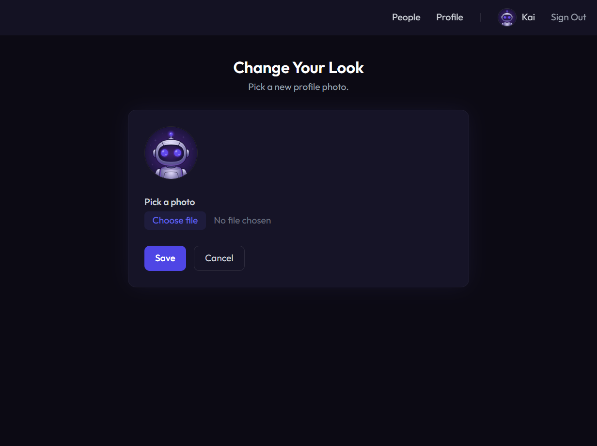

# Express Sweet Demo

A full-featured app built with Express Sweet — auth, database, file uploads, and file-based routing, all wired up and ready to run.

## Quick Start

The demo runs against the Express Sweet build in this repository (`"express-sweet": "file:../.."`), not the published package, so the library is built first. Both ESM and CommonJS versions are included.

```bash
# From the repository root
docker compose run --rm build

# Then either demo
cd demo/esm && docker compose up     # http://localhost:3000
cd demo/cjs && docker compose up     # http://localhost:3001
```

Each command starts a MariaDB container alongside the app and seeds it on first run. The app containers run Node 18, the minimum the library declares for consumers, while the build container runs Node 22.

Sign in with `kai@example.com` / `password123`.

The database lives in a Docker volume, so anything you add through the UI survives a restart. To go back to the two seed users:

```bash
docker compose down -v
```

`.env` stores the database password base64 encoded, and `hook_after_env_load` in `config/config.js` decodes it before `config/database.js` is read. The startup log shows it happening:

```
[hook_after_env_load] decoded DB_PASSWORD (13 chars) for demo@db
```

Running without Docker needs Node 18 or later and a reachable MariaDB server — see [CONTRIBUTING.md](../CONTRIBUTING.md).

## Tech Stack

| Layer | Technology |
|-------|------------|
| Framework | [Express Sweet](../) v5 on Express.js |
| Auth | Passport.js (local strategy + session) |
| Database | MariaDB via Sequelize |
| Views | Handlebars with 37 built-in helpers |
| File Upload | Multer |
| Styling | Tailwind CSS (CDN) |

## Screenshots

### Sign In


### Home


### People


### New Person


### Edit Profile


### Change Your Look


## What's Inside

| Screen | URL | Feature |
|--------|-----|---------|
| Sign In | `/login` | Passport.js authentication |
| Home | `/` | Session data, Handlebars helpers |
| People | `/users` | Sequelize model, `findAll` |
| New Person | `/users/new` | Form POST, `create` |
| Edit Profile | `/users/:id/edit` | Form PUT, `update` |
| Remove | `/users/:id` (DELETE) | Self-delete protection |
| Change Your Look | `/profile/avatar` | Multer file upload |
| Sign Out | `/logout` | Session destroy |

## File-based Routing

Files in `routes/` are automatically mapped to URL endpoints:

| File | URL |
|------|-----|
| `routes/home.js` | `/home` (also `/` via `default_router`) |
| `routes/login.js` | `/login` |
| `routes/logout.js` | `/logout` |
| `routes/users.js` | `/users`, `/users/new`, `/users/:id/edit`, `/users/:id` |
| `routes/profile/avatar.js` | `/profile/avatar` |

No manual route registration needed — just create a file and it becomes an endpoint.

## Project Structure

```
esm/
├── .env                # Environment variables (PORT, NODE_ENV)
├── app.js              # Entry point
├── setup.js            # Database setup script
├── ddl.sql             # Database schema + seed data
├── package.json
├── config/
│   ├── config.js       # App settings, routing, error pages
│   ├── database.js     # MariaDB connection
│   ├── authentication.js  # Passport.js config
│   ├── view.js         # Handlebars settings
│   ├── logging.js      # Morgan format
│   └── upload.js       # Multer config
├── public/
│   └── img/            # Avatar images
├── models/
│   └── UserModel.js    # Sequelize model
├── routes/
│   ├── home.js         # Dashboard (default route)
│   ├── login.js        # Auth login
│   ├── logout.js       # Session destroy
│   ├── users.js        # CRUD (list, create, edit, delete)
│   └── profile/
│       └── avatar.js   # File upload
└── views/
    ├── layout/
    │   └── default.hbs # Shared layout with nav
    ├── home.hbs
    ├── login.hbs
    ├── users.hbs
    ├── users-new.hbs
    ├── users-edit.hbs
    ├── avatar.hbs
    └── errors/
        ├── 404.hbs
        └── 500.hbs
```
